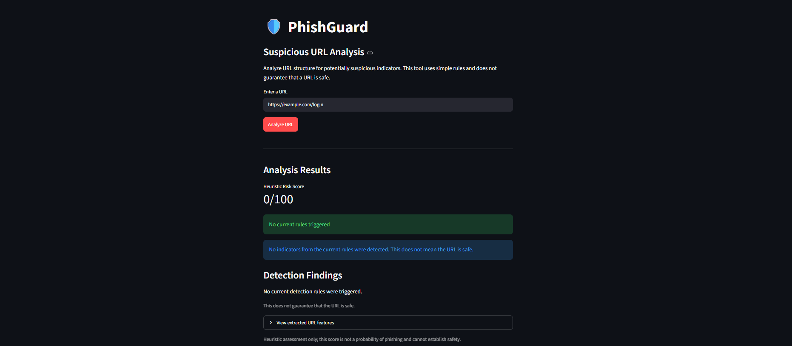

# 🛡️ PhishGuard — Suspicious URL Analyzer

PhishGuard is a Python-based cybersecurity project that analyzes URL structures and identifies potentially suspicious indicators using explainable, rule-based detection.

The application provides a simple Streamlit dashboard that displays a heuristic risk score, detection findings, and extracted URL features.
## Dashboard Preview



## Features

- **URL feature extraction:** Examines URL length, hostname, HTTPS usage, IP-address hosts, subdomain count, and the presence of an `@` symbol.
- **Rule-based detection:** Identifies several potentially suspicious URL characteristics.
- **Explainable findings:** Each triggered rule includes a severity and human-readable explanation.
- **Heuristic risk scoring:** Assigns points to detected indicators and caps the score at 100.
- **Interactive dashboard:** Analyze URLs through a Streamlit web interface.
- **Input validation:** Rejects empty URLs, unsupported schemes, and URLs without hostnames.
- **Automated tests:** Uses pytest to test feature extraction and detection logic.
- **Downloadable reports:** Export URL analysis results as formatted JSON, including the risk score, findings, extracted features, and limitations.

## Detection Rules

| Rule | Description |
|---|---|
| `IP_ADDRESS_HOST` | The hostname is an IP address. |
| `NO_HTTPS` | The URL does not use HTTPS. |
| `LONG_URL` | The URL exceeds the configured length threshold. |
| `MANY_SUBDOMAINS` | The hostname contains three or more subdomains. |
| `AT_SYMBOL` | The URL contains an `@` symbol. |
| `URL_SHORTENER` | The hostname matches a configured URL-shortening service. |

## Tech Stack

- Python
- Streamlit
- pytest
- Python standard library (`urllib.parse`, `ipaddress`)

## Getting Started

### 1. Clone the repository

```bash
git clone <>
cd phishguard
```

### 2. Create and activate a virtual environment

On Windows PowerShell:

```powershell
python -m venv .venv
.\.venv\Scripts\Activate.ps1
```

### 3. Install dependencies

```powershell
python -m pip install streamlit pytest
```

### 4. Run the application

```powershell
python -m streamlit run app.py
```

Open the local address shown in the terminal.

### 5. Run the tests

```powershell
python -m pytest -v
```

## How It Works

1. The user enters a URL in the Streamlit dashboard.
2. The analyzer parses the URL and extracts structural features.
3. The detector evaluates the features against predefined rules.
4. Triggered rules contribute points to a heuristic score.
5. The dashboard displays the score, findings, and extracted features.
6. The user can download the analysis report as a JSON file.

## Limitations

- This is an educational, rule-based analyzer, not a production phishing detection service.
- The score is a heuristic, not a probability that a URL is malicious.
- A URL with no triggered rules is not guaranteed to be safe.
- URL shortener detection does not follow redirects or inspect the final destination.
- The current rules can produce false positives and false negatives.
- The tool does not fetch webpages or verify domain reputation.

## Future Improvements

- Add domain reputation checks using a trusted threat-intelligence source.
- Improve hostname validation and URL normalization.
- Add more unit and edge-case tests.
- Add downloadable analysis reports.
- Evaluate detection performance on a labeled dataset.

## Disclaimer

PhishGuard is intended for educational and defensive cybersecurity use. Do not rely on its results as the sole basis for deciding whether a URL is safe.
